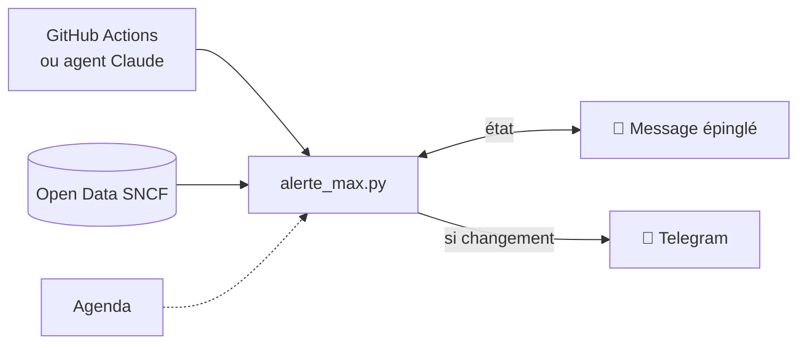

# 🚄 Alerte MAX Jeune

**Un bot qui surveille les places TGV à 0 € de l’abonnement MAX Jeune sur mon trajet du week-end, et me prévient sur Telegram dès que quelque chose change.**

[](https://github.com/ayoub-aitkaddi/alerte-max/actions/workflows/tests.yml)


*In English: a zero-dependency Python bot that polls the SNCF open-data API for free “MAX Jeune” TGV seats on a recurring weekend route, skips dates that clash with my calendar, and sends Telegram alerts only when availability changes. It runs on GitHub Actions or as a scheduled Claude agent.*

---

## Le problème

Avec l’abonnement **MAX Jeune** (anciennement TGV Max), les trajets sont gratuits, mais seulement sur les trains où il reste des places réservées aux abonnés. Sur Paris-Est ↔ Metz, ces places partent vite le vendredi soir et le dimanche. Il fallait donc vérifier SNCF Connect à la main, plusieurs fois par semaine, et souvent pour rien.

## La solution

Le bot interroge chaque jour le **jeu de données ouvert de la SNCF**, ne garde que mes créneaux, écarte les dates où j’ai déjà un engagement, puis m’écrit **seulement s’il y a du nouveau** :

```text
🚄 Du nouveau : 1 place(s) apparue(s), 1 disparue(s).

🆕 Disponibles :
• Ven 04/12 · Paris-Est → Metz · 17:40 → 19:04

❌ Plus disponibles :
• Sam 28/11 · Paris-Est → Metz · 13:39 → 15:03

👉 Recommandé : aller Ven 04/12 · Paris-Est → Metz · 17:40 → 19:04, retour Dim 06/12 · Metz → Paris-Est · 19:42 → 21:13.

ℹ️ Disponibilité indicative (données mises à jour une fois par jour) : vérifie sur SNCF Connect avant de réserver.
```

Un **message épinglé** dans la conversation montre en permanence les places suivies. Il sert aussi de mémoire au bot.

## Fonctionnalités

- 🔁 **Fenêtre glissante** : toujours les *n* prochains week-ends (3 par défaut).
- 🎯 **Créneaux configurables** : vendredi dès 15 h pour l’aller, samedi en repli, dimanche pour le retour, avec plusieurs gares possibles (Metz, Forbach).
- 📅 **Prise en compte de l’agenda** : un train qui croise un événement, avec une marge configurable, est écarté.
- 🔔 **Alertes différentielles** : places apparues et places disparues, jamais de doublon.
- 👉 **Recommandation** : premier week-end avec un aller-retour possible, en privilégiant le départ le plus tôt et le retour le plus tard.
- 🧠 **Sans base de données** : l’état est stocké dans le message Telegram épinglé, ce qui convient aux exécutions éphémères.
- 🛡️ **Robuste** : nouvelles tentatives quand l’API coupe, secrets en variables d’environnement, 19 tests unitaires.
- 📦 **Zéro dépendance** : uniquement la bibliothèque standard de Python.

## Architecture



Détails et choix techniques : [`docs/architecture.md`](docs/architecture.md). Variante pilotée par un agent IA qui lit Google Agenda : [`docs/agent-claude.md`](docs/agent-claude.md).

## Démarrage rapide

### 1. Créer le bot Telegram

1. Dans Telegram, écris à **@BotFather** : `/newbot`, puis choisis un nom. Note le **token**.
2. Envoie `/start` à ton nouveau bot.
3. Récupère ton chat ID :

```bash
export TELEGRAM_TOKEN="123456789:..."
python scripts/trouver_chat_id.py
```

### 2. Tester en local

```bash
git clone https://github.com/ayoub-aitkaddi/alerte-max.git
cd alerte-max

python alerte_max.py --dry-run                            # affiche le message sans rien envoyer
python alerte_max.py --dry-run --busy busy.example.json   # avec un agenda

export TELEGRAM_CHAT_ID="123456789"
python alerte_max.py                                      # vrai passage : alerte + message épinglé
```

### 3. Automatiser avec GitHub Actions

1. Pousse le dépôt sur GitHub.
2. Va dans **Settings → Secrets and variables → Actions** et ajoute `TELEGRAM_TOKEN` et `TELEGRAM_CHAT_ID`.
3. Le workflow [`alerte.yml`](.github/workflows/alerte.yml) tourne chaque matin. Tu peux aussi le lancer à la main depuis l’onglet **Actions**.

> GitHub désactive les workflows planifiés d’un dépôt public resté 60 jours sans activité. Un simple commit les relance.

## Configuration

Tout se règle dans [`config.json`](config.json) :

```json
{
  "fenetre_weekends": 3,
  "marge_agenda_minutes": 60,
  "aller":  { "origines": ["PARIS (intramuros)"], "destinations": ["METZ VILLE", "FORBACH"],
              "jours": { "vendredi": "15:00", "samedi": "00:00" } },
  "retour": { "origines": ["METZ VILLE", "FORBACH"], "destinations": ["PARIS (intramuros)"],
              "jours": { "dimanche": "00:00" } },
  "jours_repli": ["samedi"]
}
```

- `jours` : jours du week-end retenus et heure de départ minimale pour chacun.
- Les noms de gares doivent correspondre exactement à ceux du jeu de données. Pour les trouver, cherche ta ville dans l’[explorateur du jeu de données](https://ressources.data.sncf.com/explore/dataset/tgvmax/).

L’agenda est optionnel : il se passe avec `--busy`, sous la forme d’un fichier JSON au format de [`busy.example.json`](busy.example.json).

## Tests

```bash
python -m unittest discover -s tests -v
```

Les tests couvrent le calcul de la fenêtre glissante, les filtres (créneaux, agenda, trains déjà partis, doublons), l’écriture et la relecture de l’état (y compris le passage à la nouvelle année), le diff et la recommandation. Ils tournent en CI sur Python 3.9 et 3.12.

## Structure

```text
alerte-max/
├── alerte_max.py            # le bot (logique pure + entrées/sorties)
├── config.json              # trajets et créneaux
├── busy.example.json        # exemple d’agenda
├── scripts/trouver_chat_id.py
├── tests/test_alerte_max.py
├── docs/
│   ├── architecture.md
│   └── agent-claude.md
└── .github/workflows/
    ├── alerte.yml           # passage quotidien planifié
    └── tests.yml            # CI
```

## Limites

- **Ce n’est pas du temps réel** : le jeu de données est mis à jour une fois par jour, en début de matinée. Une place affichée peut déjà être partie.
- **Le bot ne réserve rien**, par choix : il informe, et la réservation se fait sur SNCF Connect.
- Visibilité limitée aux **30 prochains jours**, comme le jeu de données.

## Données

[Disponibilité à 30 jours de places MAX JEUNE et MAX SENIOR ouvertes à la réservation](https://ressources.data.sncf.com/explore/dataset/tgvmax/) : SNCF Open Data, sous licence [ODbL](https://data.sncf.com/pages/cgu/A1#A1).

## Licence

[MIT](LICENSE). Projet personnel, sans lien avec SNCF Voyageurs.
