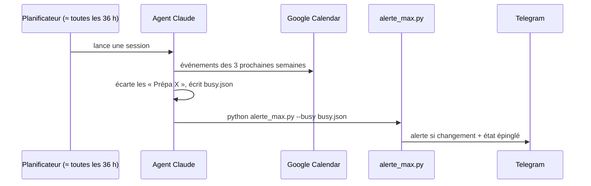

# Variante agentique avec Claude

En plus de la version GitHub Actions, le projet tourne en **tâche planifiée Claude** : un agent IA exécute le même script, mais lit d’abord l’agenda Google de l’utilisateur pour écarter les week-ends où un événement (autre que les révisions) bloque le trajet.

## Prompt de la tâche (modèle)

> Tu es l’agent d’alerte MAX Jeune de l’utilisateur. Ton seul rôle est de l’informer par Telegram : tu ne réserves jamais rien et tu ne saisis aucun identifiant ni moyen de paiement. Fais les étapes suivantes sans poser de question.
>
> 1. **Agenda** : avec le connecteur Google Calendar, liste les événements des 23 prochains jours. Écarte ceux dont le titre commence par « Prépa X ». Écris les autres dans `busy.json` (`titre`, `debut`, `fin` au format `AAAA-MM-JJTHH:MM`, heure de Paris). Si le connecteur est indisponible, écris `[]`.
> 2. **Script** : récupère `alerte_max.py` et `config.json` depuis ce dépôt.
> 3. **Exécution** : `TELEGRAM_TOKEN=… TELEGRAM_CHAT_ID=… python alerte_max.py --busy busy.json`
> 4. **En cas d’erreur** (trace Python), envoie un seul message court sur Telegram, puis arrête-toi.

Garde-fous inscrits dans le prompt : l’agent informe, il n’agit pas. Il ne fait ni réservation, ni saisie d’identifiants, ni paiement, et l’utilisateur réserve lui-même sur SNCF Connect.

## Pourquoi un agent plutôt qu’un simple cron ?

L’agenda est la seule donnée qui demande du **jugement** : savoir qu’un « TIPE : commander le matériel » est une révision qui ne bloque rien, alors qu’une conférence à Paris le samedi, si. Le script garde toute la logique déterministe, et l’agent n’intervient que là où une règle fixe serait fragile.
