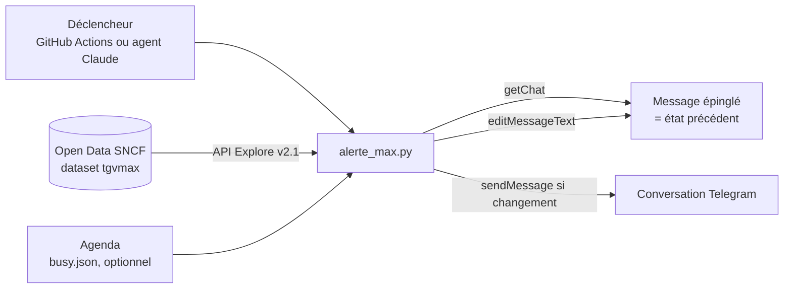

# Architecture

## Vue d’ensemble

## Déroulé d’un passage

1. **Fenêtre glissante** : `prochains_weekends()` calcule les vendredis des *n* prochains week-ends. Le dimanche, la fenêtre bascule sur le week-end suivant.
2. **Requête** : une requête par sens (aller, retour) vers l’API Explore de la SNCF, filtrée côté serveur sur les gares et les dates (`date=date'AAAA-MM-JJ'`).
3. **Filtre** : `filtrer()` ne garde que les trains marqués `od_happy_card = OUI`, dans les créneaux de `config.json`, pas encore partis et sans conflit d’agenda (avec une marge configurable avant et après le trajet). Deux numéros de train au même horaire (rames couplées) sont fusionnés.
4. **Diff** : l’état précédent est relu dans le message épinglé (`lire_etat()`), puis comparé à l’état courant : places apparues, places disparues.
5. **Notification** : un message n’est envoyé que s’il y a du nouveau. Le message épinglé est mis à jour sans notification.

## Choix techniques

| Choix | Pourquoi |
|---|---|
| Bibliothèque standard uniquement | Rien à installer, démarrage instantané en CI, surface d’attaque minimale. |
| État dans un message Telegram épinglé | Pas de base de données ni de fichier à persister entre deux exécutions éphémères (GitHub Actions, sessions cloud). L’état est lisible par l’utilisateur. Le format est textuel et relu par une expression régulière. |
| Logique pure séparée des entrées/sorties | `filtrer`, `lire_etat`, `composer_message`, `recommandation` sont testées sans réseau. |
| Nouvelles tentatives avec attente croissante | En pratique, l’API SNCF coupe une partie des connexions (`Connection reset`) : 6 essais espacés de 5 à 60 s rendent l’échec complet rare. |
| Secrets en variables d’environnement | Le token Telegram n’apparaît jamais dans le code ni dans l’historique Git. |

## Limites connues

- Les données ne sont mises à jour qu’**une fois par jour** : ce n’est pas du temps réel, et une place peut partir avant la réservation.
- Le jeu de données couvre **30 jours** : au-delà, rien n’est visible.
- Les noms de gares doivent correspondre exactement à ceux du jeu de données (`PARIS (intramuros)`, `METZ VILLE`…).
